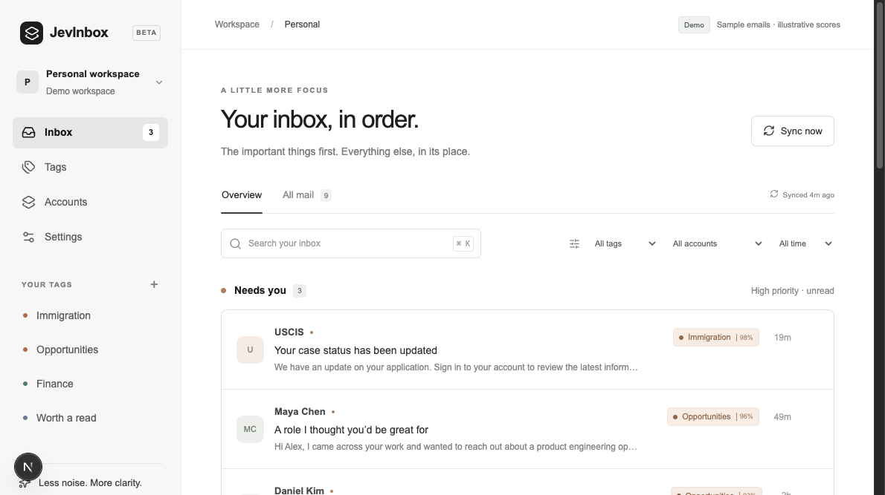

# evailbox

A self-hosted inbox for Gmail and Outlook. Write tag rules in plain language ("offers from recruiters", "anything about my visa case"). evailbox checks each new email against them and puts what matters at the top. You can then reply, mark as read or archive.

Everything runs in one Next.js process on your machine: the app, a background sync worker and a SQLite database. There are no hosted services to sign up for. You bring your own Google and Microsoft OAuth apps and, optionally, an AI Gateway key for tagging, and paste them into **Settings**.



## Quick start

Requires Node.js 22.

```sh
git clone https://github.com/Solomon-mithra/evailbox.git
cd evailbox
npm install
npm run dev
```

Open <http://localhost:3000>. The first run creates `data/evailbox.db` and a random encryption key in `data/secret.key`. Back up both: losing the key means reconnecting every mailbox.

Then go to **Settings → Mail and AI keys** and follow the steps for each provider you want. Every row shows the exact redirect URI to copy.

To look around without any keys, run the demo with sample mail:

```sh
APP_MODE=demo npm run dev
```

## Connecting Gmail

1. In [Google Cloud](https://console.cloud.google.com/), create a project (or reuse one) and [enable the Gmail API](https://console.cloud.google.com/apis/library/gmail.googleapis.com).
2. Configure the **OAuth consent screen**. While the app is in _Testing_, add each Google account you'll connect as a test user.
3. Under [Credentials](https://console.cloud.google.com/apis/credentials), create an **OAuth client ID** of type _Web application_. Add the redirect URI shown in Settings, by default `http://localhost:3000/api/accounts/gmail/callback`.
4. Paste the client ID and secret into **Settings → Google (Gmail)**, then connect an account from **Accounts**.

evailbox requests the `gmail.modify` scope (read, mark read, archive and send replies). Google treats it as a restricted scope, which is fine for personal use with test users. Publishing the app to arbitrary users requires Google's verification.

## Connecting Outlook

1. In [App registrations](https://portal.azure.com/#view/Microsoft_AAD_RegisteredApps/ApplicationsListBlade), create a registration. For both work and personal accounts, choose _Accounts in any organizational directory and personal Microsoft accounts_.
2. Add a **Web** redirect URI: `http://localhost:3000/api/accounts/outlook/callback` (or the one shown in Settings).
3. Under **API permissions**, add the Microsoft Graph delegated permissions `Mail.ReadWrite`, `Mail.Send`, `User.Read` and `offline_access`.
4. Under **Certificates & secrets**, create a client secret and copy its _Value_.
5. Paste the application (client) ID and secret into **Settings → Microsoft (Outlook)**. Keep the tenant as `common` unless you registered a single-tenant app.

## AI tagging

Tags are evaluated by the [Jev](https://vercel.com/changelog/typesafe-ai-jev-now-available-on-ai-gateway) evaluation model through [Vercel AI Gateway](https://vercel.com/docs/ai-gateway). Create an AI Gateway API key and paste it into **Settings → AI tagging**. Usage is billed to your Vercel account.

Without a key, everything else still works: sync, reading, replies, drafts and archive. Tags simply don't match anything until a key is added, and then the existing backlog is checked automatically.

Each email body is fetched from your provider when it's checked, sent to the gateway with your tag rules, and discarded. Bodies are never stored in the database.

## Configuration

Nothing is required. Every variable is optional:

| Variable                | Default                   | Purpose                                                                                                                                                                                                                |
| ----------------------- | ------------------------- | ---------------------------------------------------------------------------------------------------------------------------------------------------------------------------------------------------------------------- |
| `NEXT_PUBLIC_APP_URL`   | `http://localhost:3000`   | The address you open evailbox at. OAuth redirect URIs are built from it, and requests for any other host are refused, which protects against DNS rebinding. Set it when using another port, a LAN address or a domain. |
| `APP_PASSWORD`          | unset                     | At least 12 characters. When set, the app asks for this password. **Set it whenever evailbox is reachable by anyone but you.**                                                                                         |
| `ALLOW_NO_PASSWORD`     | unset                     | evailbox refuses to serve a non-localhost `NEXT_PUBLIC_APP_URL` without `APP_PASSWORD`. Set to `1` only on a network you fully trust.                                                                                  |
| `DATABASE_URL`          | `file:./data/evailbox.db` | SQLite file location.                                                                                                                                                                                                  |
| `ENCRYPTION_SECRET_KEY` | `data/secret.key`         | 64 hex characters. Overrides the generated key that encrypts OAuth tokens and stored keys.                                                                                                                             |
| `APP_MODE`              | `live`                    | `demo` serves sample mail and never calls providers.                                                                                                                                                                   |

OAuth and AI keys entered in Settings take precedence. For container setups you can instead provide `NEXT_PUBLIC_GOOGLE_CLIENT_ID`, `GOOGLE_CLIENT_SECRET`, `NEXT_PUBLIC_MICROSOFT_CLIENT_ID`, `MICROSOFT_CLIENT_SECRET`, `MICROSOFT_TENANT_ID` and `JEV_API_KEY` as environment variables. Copy `.env.example` to `.env.local` to set any of these.

## Running it for real

```sh
npm run build
npm start   # applies migrations, then serves on port 3000
```

Run a single instance: the background worker lives inside the server process, and SQLite expects one writer. Put it behind HTTPS (Caddy, nginx, Tailscale) if you open it to the network. Set `NEXT_PUBLIC_APP_URL` to the public address, set `APP_PASSWORD`, and update the redirect URIs in your Google and Microsoft apps.

Mail syncs every two minutes while the server runs, and immediately when you press **Sync now**. New connections import the latest 100 Inbox emails and then follow new mail.

## How it works

- **Next.js 16** App Router UI and API routes, React 19, TanStack Query, Tailwind CSS 4.
- **SQLite via Prisma.** Accounts, email summaries, tags, decisions and drafts. Email bodies aren't stored.
- **Background worker** (`src/lib/background.ts`). An in-process loop that imports one provider page at a time and classifies in bounded batches. Durable work flags in the database let a restart pick up where it left off.
- **Providers.** Direct Gmail REST and Microsoft Graph calls with OAuth 2.0 + PKCE. Tokens are encrypted with AES-256-GCM.
- **Personal and Work workspaces.** Each has its own accounts, tags and rules.

More detail lives in [docs/](docs/README.md).

## Development

```sh
npm test            # vitest
npm run lint
npm run typecheck
npm run build
```

Read [AGENTS.md](AGENTS.md) before changing framework code: this Next.js version differs from older releases.

Contributions are welcome. Please open an issue to discuss larger changes first, and keep pull requests focused with tests for new logic.

## License

[MIT](LICENSE)
