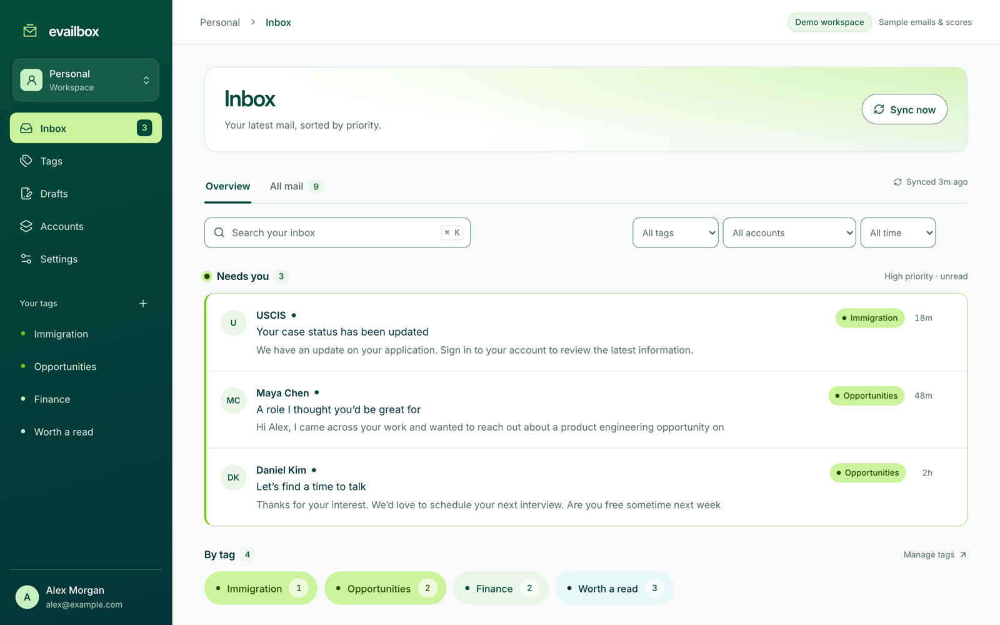
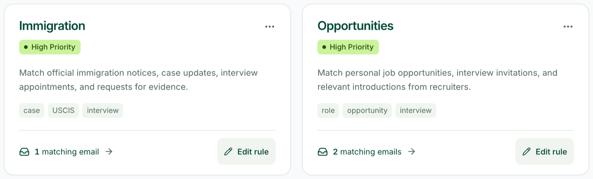
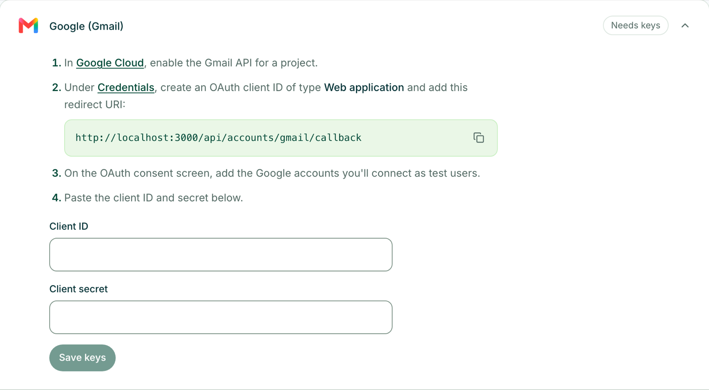

<p align="center">
  
</p>

<h1 align="center">evailbox</h1>

<p align="center">
  <strong>Gmail and Outlook, triaged by rules you write in plain English.</strong><br />
  Self-hosted. One Next.js app. Your keys, your machine.
</p>

<p align="center">
  <a href="LICENSE"></a>
  
  
  
</p>

<p align="center">
  <a href="#quick-start">Quick start</a> ·
  <a href="#features">Features</a> ·
  <a href="#connect-your-mail">Connect your mail</a> ·
  <a href="#self-hosting">Self-hosting</a> ·
  <a href="#how-it-works">How it works</a> ·
  <a href="#faq">FAQ</a>
</p>



## Why evailbox

Important email hides among newsletters, receipts and notifications. Mail filters match keywords, so they miss the message that matters and catch the one that doesn't. Hosted AI inboxes solve this by asking you to hand your mailbox to someone else's servers.

evailbox takes a different path. You describe what matters in a sentence, such as _"official updates on my immigration case"_ or _"recruiters reaching out about roles"_. evailbox checks each new email against those rules and lifts the matches into a **Needs you** lane. It runs entirely on your machine, against OAuth apps you own, and never stores the body of a single email.

## Features

- **Tags written in plain language.** Describe what you care about, set a priority, and optionally add keywords or senders as hints. High-priority unread matches land in **Needs you**.
- **Gmail and Outlook in one inbox.** Connect several accounts from either provider; search, filter by tag, account or date.
- **Personal and Work workspaces.** Each keeps its own accounts, tags and rules, and the two never mix.
- **Act without switching apps.** Reply, reply all, save drafts, mark as read, archive or mark handled. Nothing is ever sent without your click.
- **Private by design.** Email bodies are fetched on demand and never written to disk. OAuth tokens and keys are encrypted with AES-256-GCM, and messages render in a sandboxed reader.
- **Zero configuration.** No database server, no queue, no environment variables. `npm run dev` creates a SQLite file and an encryption key, and you paste your keys into **Settings**.
- **Try it in seconds.** Demo mode serves a realistic sample inbox without any accounts.

**Rules you can read.** Each tag is a sentence plus optional hints, with a live count of matching email.



**Setup that tells you exactly what to do.** Settings walks through each provider and shows the redirect URI to copy.



## Quick start

You need Node.js 22.

```sh
git clone https://github.com/Solomon-mithra/evailbox.git
cd evailbox
npm install
npm run dev
```

Open <http://localhost:3000>, go to **Settings → Mail and AI keys**, and follow the steps for Gmail or Outlook. Then connect an account from **Accounts** and create your first tag.

Want to look around first? Start the demo with sample mail:

```sh
APP_MODE=demo npm run dev
```

## Connect your mail

evailbox connects through OAuth apps that you register, so no shared app or vendor sits between you and your mailbox. Each provider takes a few minutes to set up, and **Settings** walks you through it with the exact redirect URI to copy.

<details>
<summary><strong>Gmail</strong></summary>

1. In [Google Cloud](https://console.cloud.google.com/), create a project and [enable the Gmail API](https://console.cloud.google.com/apis/library/gmail.googleapis.com).
2. Configure the **OAuth consent screen**. While the app is in _Testing_, add each Google account you'll connect as a test user.
3. Under [Credentials](https://console.cloud.google.com/apis/credentials), create an **OAuth client ID** of type _Web application_ and add the redirect URI shown in Settings (by default `http://localhost:3000/api/accounts/gmail/callback`).
4. Paste the client ID and secret into **Settings → Google (Gmail)**.

evailbox requests the `gmail.modify` scope, which lets it read, mark as read, archive and send your replies. Google classifies it as restricted: personal use with test users works immediately, while publishing the app for anyone to use requires Google's verification.

</details>

<details>
<summary><strong>Outlook and Microsoft 365</strong></summary>

1. In [App registrations](https://portal.azure.com/#view/Microsoft_AAD_RegisteredApps/ApplicationsListBlade), create a registration for _accounts in any organizational directory and personal Microsoft accounts_.
2. Add a **Web** redirect URI: `http://localhost:3000/api/accounts/outlook/callback`, or the one shown in Settings.
3. Under **API permissions**, add the Microsoft Graph delegated permissions `Mail.ReadWrite`, `Mail.Send`, `User.Read` and `offline_access`.
4. Under **Certificates & secrets**, create a client secret and copy its _Value_.
5. Paste the application (client) ID and secret into **Settings → Microsoft (Outlook)**. Keep the tenant as `common` unless your app is single-tenant.

</details>

<details>
<summary><strong>AI tagging</strong></summary>

Tags are evaluated by the [Jev](https://vercel.com/changelog/typesafe-ai-jev-now-available-on-ai-gateway) evaluation model through [Vercel AI Gateway](https://vercel.com/docs/ai-gateway). Create an AI Gateway API key and paste it into **Settings → AI tagging**. Usage is billed to your Vercel account.

The key is optional. Without it, sync, reading, replies, drafts and archive all work; tags simply wait. When you add a key, evailbox checks the mail it has already imported.

For each check, evailbox fetches the email from your provider, sends a bounded excerpt with your tag rules to the gateway, and discards it.

</details>

## Self-hosting

Run evailbox as a long-lived service:

```sh
npm run build
npm start          # applies database migrations, then serves on port 3000
```

**Run one instance.** The background worker lives inside the server process, and SQLite expects a single writer. Mail syncs every two minutes and immediately when you press **Sync now**. A new connection imports the latest 100 emails in the Inbox, then follows new mail.

**Back up `data/`.** It holds the database (`evailbox.db`) and the encryption key (`secret.key`). Losing the key means reconnecting every mailbox.

**Expose it deliberately.** The server listens only on `127.0.0.1` by default. To reach it from other devices:

1. Set `APP_PASSWORD` (at least 12 characters).
2. Set `NEXT_PUBLIC_APP_URL` to the address you'll use, such as `https://mail.example.com`.
3. Put it behind HTTPS (Caddy, nginx or Tailscale), or set `HOST=0.0.0.0` to listen on all interfaces.
4. Add the new redirect URIs to your Google and Microsoft apps.

evailbox refuses to serve a non-local address or interface without a password, so a misconfigured server fails closed instead of exposing your inbox.

### Configuration

Every variable is optional. Copy `.env.example` to `.env.local` to set any of them.

| Variable                | Default                   | Purpose                                                                                                      |
| ----------------------- | ------------------------- | ------------------------------------------------------------------------------------------------------------ |
| `NEXT_PUBLIC_APP_URL`   | `http://localhost:3000`   | The address you open evailbox at. Redirect URIs are built from it, and requests for other hosts are refused. |
| `APP_PASSWORD`          | unset                     | Requires a password to use the app. At least 12 characters. Required when exposed beyond this machine.       |
| `HOST`                  | `127.0.0.1`               | The interface `npm run dev` and `npm start` listen on. `0.0.0.0` accepts other machines.                     |
| `ALLOW_NO_PASSWORD`     | unset                     | Set to `1` to serve a non-local address without a password. Use only on a network you fully trust.           |
| `DATABASE_URL`          | `file:./data/evailbox.db` | SQLite file location.                                                                                        |
| `ENCRYPTION_SECRET_KEY` | `data/secret.key`         | 64 hex characters that override the generated encryption key.                                                |
| `APP_MODE`              | `live`                    | `demo` serves sample mail and never contacts a provider.                                                     |

Keys saved in **Settings** take precedence. For containers, you can supply them as `NEXT_PUBLIC_GOOGLE_CLIENT_ID`, `GOOGLE_CLIENT_SECRET`, `NEXT_PUBLIC_MICROSOFT_CLIENT_ID`, `MICROSOFT_CLIENT_SECRET`, `MICROSOFT_TENANT_ID` and `JEV_API_KEY` instead.

## How it works

```mermaid
flowchart LR
  you([Your browser]) --> app
  subgraph app [evailbox: one Node.js process]
    ui[Next.js UI and API] --> db[(SQLite)]
    worker[Background worker] --> db
  end
  worker -- OAuth 2.0 + PKCE --> gmail[Gmail API]
  worker -- OAuth 2.0 + PKCE --> graph[Microsoft Graph]
  worker -- excerpt + tag rules --> gateway[AI Gateway: Jev]
```

1. Connecting an account, pressing **Sync now** or editing a tag records durable work in SQLite and wakes the worker.
2. The worker imports one page of mail at a time, saving summaries and the provider cursor in a single transaction.
3. It then checks up to 20 emails against your tags. A decision is reused until the email, the tag or the model changes.
4. The interface reads summaries and decisions from SQLite and fetches full messages live when you open them.

| Layer    | Technology                                                          |
| -------- | ------------------------------------------------------------------- |
| App      | Next.js 16 (App Router), React 19, TypeScript, Tailwind CSS 4       |
| Data     | SQLite through Prisma, TanStack Query on the client                 |
| Mail     | Gmail REST API and Microsoft Graph, called directly                 |
| AI       | AI SDK 7 native evaluation on Vercel AI Gateway (`typesafe-ai/jev`) |
| Security | AES-256-GCM for tokens and keys, PKCE, host and origin allowlists   |
| Tests    | Vitest against a real SQLite database                               |

Read the [architecture notes](docs/engineering/ENGINEERING.md) and [provider details](docs/engineering/PROVIDERS.md) for the full picture.

## Privacy and security

| Stored in your database                          | Never stored                      |
| ------------------------------------------------ | --------------------------------- |
| Subject, sender, snippet and flags of each email | Email bodies                      |
| Tags, decisions and your reply drafts            | Attachments                       |
| Encrypted OAuth tokens and keys                  | Your Google or Microsoft password |

Email content leaves your machine only in two ways: to your own provider, and, if you add a key, as a bounded excerpt sent to the AI Gateway for tagging. Logs record events and status codes, never message content.

Found a vulnerability? Please report it privately through [GitHub security advisories](https://github.com/Solomon-mithra/evailbox/security/advisories/new) instead of opening a public issue.

## FAQ

**Is it free?** evailbox is free and MIT licensed. Gmail and Outlook API access is free for personal use. AI tagging is billed by Vercel AI Gateway, based on how much mail you check.

**Why do I need my own OAuth apps?** They keep your mail between you and your provider. No shared app means no company in the middle that could read, lose or leak your inbox.

**Can several people share one instance?** Each instance has one owner. Run a separate instance for each person.

**Does it work without AI?** Yes. Without a key, evailbox is a fast, private, unified inbox; tags start matching when you add one.

**Does it run on Windows?** Use WSL, or start it with `npx next dev -H 127.0.0.1`.

## Roadmap

These are open for contribution:

- A Docker image and one-click deploy templates
- IMAP support for providers beyond Gmail and Outlook
- Local models for tagging, so no email leaves your machine at all
- Push notifications from Gmail and Microsoft Graph instead of polling

## Contributing

Contributions are welcome. Open an issue to discuss larger changes first, keep pull requests focused, and include tests for new logic.

```sh
npm test           # Vitest
npm run lint
npm run typecheck
npm run build
```

This project uses Next.js 16, which differs from earlier releases. Read [AGENTS.md](AGENTS.md) and the bundled docs in `node_modules/next/dist/docs/` before changing framework code.

## License

[MIT](LICENSE) © Solomon Mithra
