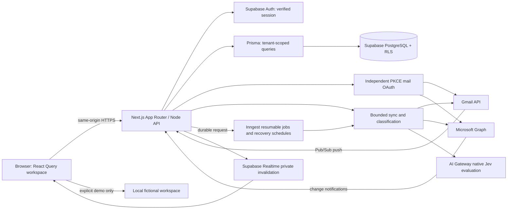
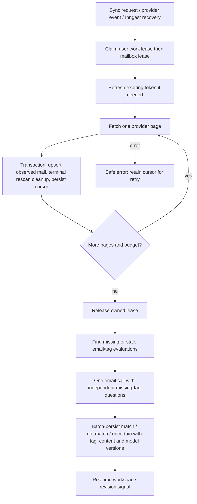

# Engineering design

Source of truth: `prisma/schema.prisma`, `prisma/migrations/` (initial schema and Personal/Work upgrade), `src/app/api/[...path]/route.ts` and service modules. Reviewed 2026-09-21; Phase 7 surfaces updated 2026-09-25 (see [Phase 7](../phases/PHASE_7.md)). Push notifications and digests are retired: their historical tables remain inert, and no route, worker or dependency delivers them. A source implementation is not external validation; deployment, live OAuth, mailbox, model and delivery checks require separate evidence.

## Routes, identity and UI ownership

| Surface               | Route / module                                                                 | Contract                                                                                                        |
| --------------------- | ------------------------------------------------------------------------------ | --------------------------------------------------------------------------------------------------------------- |
| Public homepage       | `/`, `src/app/page.tsx`, `src/app/page.module.css`                             | Indexable evailbox introduction; **Open inbox** links to `/inbox`; no Supabase initialization for the root page |
| Illustrative example  | `src/components/landing-example.tsx`                                           | Personal/Work rule-to-matches example with labeled synthetic results and keyboard-operable selectors            |
| App                   | `/inbox`, `/tags`, `/tags/[id]`, `/drafts`, `/accounts`, `/settings`           | Session-gated in live mode; explicit demo bypass; application metadata is noindex                               |
| Provider marks        | `src/components/provider-logo.tsx`, `/brands/gmail.svg`, `/brands/outlook.svg` | Shared local SVGs; exact asset routes remain public for signed-out visitors                                     |
| Identity and theme    | `src/components/brand-mark.tsx`, `public/icon.svg`, `src/app/globals.css`      | evailbox mark; local Inter; cool off-white app canvas with retained box gradients; separate landing backdrop    |
| Browser compatibility | `src/lib/browser-storage.ts`                                                   | Preserve old demo state and workspace selection while migrating to evailbox keys                                |
| Pricing               | `/pricing`, `src/lib/plans.ts`                                                 | Public, indexable Starter $14/5,000 and Heavy $24/10,000 preview; billing and allowance enforcement are off     |

Legacy root links containing `email` or `workspace` redirect to `/inbox` with query parameters preserved. Auth callbacks, app navigation and reset destinations use `/inbox`. Jev's model name, `JEV_*` settings and historical repository/deployment URLs retain their technical values. See [workspaces](WORKSPACES.md), [theme](THEME.md) and [provider sources](PROVIDER_LOGOS.md).

## Architecture



UI queries and mutations use JSON APIs; live server-side sessions are verified with Supabase `getUser()`. `proxy.ts` refreshes auth cookies and protects private page navigation, while APIs enforce authentication independently. Demo mode is explicit (`APP_MODE=demo`); it does not connect to the database/providers and live operations fail with `DEMO_MODE` rather than pretending to succeed.

```mermaid
sequenceDiagram
  participant UI as Signed-in browser
  participant API as Mail OAuth endpoints
  participant P as Google or Microsoft
  participant DB as Database
  UI->>API: GET accounts/provider/auth
  API->>API: Generate verifier; encrypted user/provider/workspace/state; 10-minute cookie
  API-->>UI: Redirect with PKCE S256
  UI->>P: Consent to mail access (gmail.modify / Mail.ReadWrite Mail.Send)
  P-->>API: Code + state callback
  API->>API: Match cookie; validate state age, provider and user; restore originating workspace
  API->>P: Exchange code + verifier
  API->>P: Get authorized mailbox identity
  API->>DB: Upsert account with AES-GCM encrypted tokens
  API-->>UI: Redirect to Accounts
```



## Module ownership

- `env.ts` and instrumentation validate configuration; demo/live behavior must be intentional.
- `auth.ts`, `proxy.ts`, `oauth.ts`, `crypto.ts`: sessions, protected pages, provider connection, encrypted credentials and state.
- `providers/`: bounded external OAuth/mail protocols. See [PROVIDERS.md](PROVIDERS.md) for cursor and HTTP rules.
- `workspace.ts`, `validation.ts`, API dispatch: public projections, tenant-scoped reads/mutations and request contracts.
- `work-queue.ts`: durable requests/revisions, user leases, backoff and oldest-attempt scheduling.
- `sync.ts`: account lease ownership, refresh, transactional pages, terminal rescan reconciliation, deadline/page limits and classification handoff.
- `classification.ts`, `classification-version.ts`, `jev.ts`: bounded-concurrency recent-first evaluation, content/tag/model freshness, guarded batch saves, retryable errors and deterministic probability traces.
- `inbox.ts`, `query-cache.ts`: body-free cursor reads and user/workspace-partitioned IndexedDB summary persistence.
- `inngest/`, `realtime.ts`, `mailbox-subscriptions.ts`, `providers/webhooks.ts`: durable background jobs, private invalidation, authenticated provider events and renewal. See [MAILBOX_EVENTS.md](MAILBOX_EVENTS.md).
- `mail-actions.ts`, `providers/actions.ts`: reply/reply-all drafts, lease-claimed explicit sends with unknown-state reconciliation, read/unread and archive.
- `plans.ts`, `account-management.ts`, `scripts/grant-plan.ts`: preview plans, trusted server-side entitlements, UTC-month usage and administrative grants.
- Client hooks/components: React Query cache, local demo operations, forms, navigation and display. Server secrets never cross the boundary.

## API contract

All JSON success responses use `{ "data": ... }`; failures use `{ "error": { "code", "message", "details"? } }`. Success responses use `Cache-Control: no-store`. Standard errors include 400 invalid input/JSON, 401 unauthenticated, 403 invalid origin, 404 tenant-scoped not found, 409 conflict, 413 oversized body, 500 safe internal error and 503 live action in demo mode. Every mutation requires an Origin exactly matching `NEXT_PUBLIC_APP_URL`; JSON bodies are bounded to 20,000 characters. Redirect endpoints return redirects rather than the JSON envelope.

| Method and endpoint                                      | Authentication            | Input / behavior                                                                                                                                                                                                     |
| -------------------------------------------------------- | ------------------------- | -------------------------------------------------------------------------------------------------------------------------------------------------------------------------------------------------------------------- |
| `GET /api/health`                                        | Public                    | `{status, mode}`; does not prove DB/provider health.                                                                                                                                                                 |
| `POST /api/auth/signin`                                  | Public, live, same-origin | Starts Supabase Google OAuth; returns redirect URL.                                                                                                                                                                  |
| `GET /api/auth/callback`                                 | OAuth code                | Exchanges sign-in code; redirects to callback page or error sign-in.                                                                                                                                                 |
| `GET /api/auth/me`                                       | User                      | Verified application user.                                                                                                                                                                                           |
| `POST /api/auth/signout`                                 | User                      | Clears Supabase session.                                                                                                                                                                                             |
| `GET /api/workspace`                                     | User                      | Combined workspace and paged email query described below.                                                                                                                                                            |
| `GET /api/tags`                                          | User                      | Own tags ordered by creation.                                                                                                                                                                                        |
| `POST /api/tags`                                         | User                      | Full tag input; maximum 30 tags per workspace; returns 201.                                                                                                                                                          |
| `GET /api/tags/:id`                                      | User                      | Own tag or 404.                                                                                                                                                                                                      |
| `PATCH /api/tags/:id`                                    | User                      | Partial tag input; increments version, removes existing tag classifications transactionally.                                                                                                                         |
| `DELETE /api/tags/:id`                                   | User                      | Deletes own tag; classification cascade.                                                                                                                                                                             |
| `GET /api/accounts`                                      | User                      | Public account fields only: id, provider, email, lastSync, syncError.                                                                                                                                                |
| `GET /api/accounts/gmail/auth`                           | User                      | Starts independent Gmail PKCE consent redirect.                                                                                                                                                                      |
| `GET /api/accounts/gmail/callback`                       | User + OAuth state        | Validates state and connects Gmail.                                                                                                                                                                                  |
| `GET /api/accounts/outlook/auth`                         | User                      | Starts Microsoft PKCE consent redirect.                                                                                                                                                                              |
| `GET /api/accounts/outlook/callback`                     | User + OAuth state        | Validates state and connects Outlook.                                                                                                                                                                                |
| `DELETE /api/accounts/:id`                               | User                      | Removes own mailbox and cached mail/classifications; does not revoke remote consent.                                                                                                                                 |
| `POST /api/sync`                                         | User                      | `{accountId?}`; durably marks work and returns 202; Inngest performs fetching and classification. Dispatch failure leaves recoverable work.                                                                          |
| `POST /api/classify`                                     | User                      | `{emailId, tagId?}`; explicit email required; force requested evaluation.                                                                                                                                            |
| `POST /api/classify/batch`                               | User                      | `{emailId?, emailIds?, tagId?}`; max 20 explicit IDs; without IDs process up to 100 pending candidate emails. User work lease prevents ordinary concurrent evaluation; durable pending work continues automatically. |
| `GET /api/emails`                                        | User                      | Same aggregate workspace response/filter query as `/api/workspace`, not a bare array.                                                                                                                                |
| `GET /api/emails/:id`                                    | User                      | Own email with current-version tag classifications.                                                                                                                                                                  |
| `PATCH /api/emails/:id`                                  | User                      | `{handled: boolean}`; local state only; provider read/archive uses the actions endpoint.                                                                                                                             |
| `GET /api/settings`                                      | User                      | Creates defaults if absent; returns safe preferences projection.                                                                                                                                                     |
| `PATCH /api/settings`                                    | User                      | Partial preference input; no server secret fields.                                                                                                                                                                   |
| `GET /api/inbox`                                         | User                      | 50 body-free summaries with current classifications and an opaque user/workspace/filter-bound `nextCursor`.                                                                                                          |
| `GET /api/workspace/metadata`                            | User                      | Tags and safe accounts only.                                                                                                                                                                                         |
| `GET /api/workspace/counts`                              | User                      | `total`, `needsTotal` and current-version `tagCounts`.                                                                                                                                                               |
| `GET /api/emails/:id/draft`                              | User                      | `?mode=reply\|reply-all`; saved draft plus provider-derived recipients/thread context, or an actionable reconnect notice.                                                                                            |
| `PATCH /api/emails/:id/draft`                            | User                      | `{body, mode, revision}`; revision-checked autosave; conflicts return 409.                                                                                                                                           |
| `POST /api/emails/:id/reply`                             | User                      | `{intent:"send", draftId, revision}` claims and sends once; `{intent:"reconcile"}` checks an uncertain send without resending.                                                                                       |
| `POST /api/emails/:id/actions`                           | User                      | `{action:"read"\|"unread"\|"archive"}` applied through the provider.                                                                                                                                                 |
| `GET /api/drafts`                                        | User                      | Workspace draft summaries without bodies.                                                                                                                                                                            |
| `GET /api/account`, `PATCH /api/account`                 | User                      | Profile, trusted plan, UTC-month usage; PATCH accepts only `displayName` and a non-billing `requestedPlan`.                                                                                                          |
| `POST /api/webhooks/gmail`, `POST /api/webhooks/outlook` | Provider-authenticated    | Verified Pub/Sub JWT or Graph clientState/subscription identity; requests scoped work only.                                                                                                                          |
| `/api/inngest`                                           | Inngest signing key       | Serves resumable fetch, classification, renewal and recovery functions.                                                                                                                                              |
| `DELETE /api/user`                                       | User                      | `{confirm:"DELETE"}`; deletes Supabase identity, application user/cascades, session.                                                                                                                                 |
| `GET /api/cron/sync`                                     | Cron bearer secret        | Manual/fallback trigger; not scheduled by default. Marks accounts/users requested; demo returns skipped.                                                                                                             |
| `GET /api/cron/work`                                     | Cron bearer secret        | Manual/fallback trigger; not scheduled by default. Republishes due durable work to Inngest.                                                                                                                          |

Workspace-scoped account, tag, email, sync and classification APIs accept `workspace=PERSONAL|WORK`; omission defaults to `PERSONAL` and invalid values fail validation. OAuth persists the originating workspace in encrypted state. Preferences, plans and user deletion remain account-wide. Background workers cover both spaces while pairing only same-workspace email and rules.

Workspace query: `search` ≤200 characters; `tag` and `account` IDs ≤100; `range=week|month|all`; zero-based `page` 0–10000. Filters compose. Page size is 50; order is receivedAt descending then id descending. Search covers subject, sender and senderName. The response includes `user` (including workRequested), `tags`, safe `accounts`, `emails`, `preferences`, `total`, `page`, `pageSize`, `needsYou`, `needsTotal` and `tagCounts`. Email bodies are not stored; the reader fetches full content from the provider. Stale classifications are filtered out of returned email details. `tagCounts` aggregates current matches across the selected workspace, rather than counting the loaded page. UI-only grouping controls must not be mistaken for undocumented query parameters.

Tag input: trimmed name 1–60, description ≤500, prompt 10–2000, priority HIGH/MEDIUM/LOW, ≤30 keywords of 1–80 chars, ≤30 valid email sender hints. Unknown fields rejected. Tag names are case-insensitive unique per user/workspace, with a 30-tag limit in each space. Preferences: refreshMinutes 1–60 only. Legacy notification columns remain in the database but are neither read nor writable through the API.

## Relational model and field dictionary

`User.id` is the Supabase Auth UUID. Other model IDs are application-generated CUID strings. All application relations cascade on delete; the SQL migration also links users.id to auth.users.id with ON DELETE CASCADE. `Priority` values are HIGH/MEDIUM/LOW; `Provider` values are GMAIL/OUTLOOK. `WorkspaceKind` values are PERSONAL/WORK; existing rows default to PERSONAL. `?` means nullable, `[]` means a PostgreSQL array, and relation fields are Prisma navigation properties rather than extra SQL columns.

### User

| Field                  | Type                    | Meaning                                                                                                  |
| ---------------------- | ----------------------- | -------------------------------------------------------------------------------------------------------- |
| `id`                   | `String`                | Supabase Auth user UUID and primary key                                                                  |
| `email`                | `String`                | Unique sign-in email / digest recipient                                                                  |
| `lastBackgroundSyncAt` | `DateTime?`             | Last worker attempt; oldest/null requested users are selected first for fairness                         |
| `workRequested`        | `Boolean`               | Durable outstanding-work flag; defaults false                                                            |
| `workRevision`         | `Int`                   | Request generation counter; increments on new work and guards completion against clearing newer requests |
| `workLeaseId`          | `String?`               | Current random user-worker owner ID                                                                      |
| `workLeaseUntil`       | `DateTime?`             | User-worker lease expiry, allowing crash recovery                                                        |
| `workNotBefore`        | `DateTime`              | Earliest automatic retry time; defaults now                                                              |
| `workFailures`         | `Int`                   | Consecutive failed-pass counter used for backoff; defaults zero                                          |
| `createdAt`            | `DateTime`              | Application user creation time                                                                           |
| `tags`                 | `Tag[]`                 | Owned tags                                                                                               |
| `accounts`             | `EmailAccount[]`        | Connected mailboxes                                                                                      |
| `emails`               | `Email[]`               | Cached messages                                                                                          |
| `classifications`      | `EmailClassification[]` | Owned evaluation records                                                                                 |
| `notificationPref`     | `NotificationPref?`     | Optional one-to-one delivery settings                                                                    |
| `subscriptions`        | `PushSubscription[]`    | Browser/device push subscriptions                                                                        |
| `digestHistory`        | `DigestHistory[]`       | Per-local-date delivery records                                                                          |

### Tag

| Field             | Type                    | Meaning                                                             |
| ----------------- | ----------------------- | ------------------------------------------------------------------- |
| `id`              | `String`                | Tag primary key                                                     |
| `userId`          | `String`                | Owning user UUID                                                    |
| `workspace`       | `WorkspaceKind`         | PERSONAL or WORK; defaults to PERSONAL                              |
| `name`            | `String`                | Displayed tag name                                                  |
| `nameKey`         | `String`                | Lowercase name used for per-user/workspace uniqueness               |
| `description`     | `String`                | Optional user-facing description; defaults empty                    |
| `prompt`          | `String`                | User-defined semantic classification criteria                       |
| `priority`        | `Priority`              | HIGH/MEDIUM/LOW; default MEDIUM                                     |
| `keywords`        | `String[]`              | Supporting keyword hints; default empty array                       |
| `senders`         | `String[]`              | Supporting sender-address hints; default empty array                |
| `version`         | `Int`                   | Evaluation invalidation version; starts at 1 and increments on edit |
| `createdAt`       | `DateTime`              | Creation time                                                       |
| `updatedAt`       | `DateTime`              | Automatically updated modification time                             |
| `user`            | `User`                  | Owning user relation                                                |
| `classifications` | `EmailClassification[]` | Evaluations for this tag                                            |

### EmailAccount

| Field             | Type            | Meaning                                                                                                                                |
| ----------------- | --------------- | -------------------------------------------------------------------------------------------------------------------------------------- |
| `id`              | `String`        | Mailbox primary key                                                                                                                    |
| `userId`          | `String`        | Owning user UUID                                                                                                                       |
| `workspace`       | `WorkspaceKind` | PERSONAL or WORK; defaults to PERSONAL                                                                                                 |
| `provider`        | `Provider`      | GMAIL or OUTLOOK                                                                                                                       |
| `email`           | `String`        | Provider-verified mailbox address                                                                                                      |
| `accessToken`     | `String`        | Versioned AES-256-GCM ciphertext, never public API data                                                                                |
| `refreshToken`    | `String?`       | Optional encrypted offline/rotated refresh token                                                                                       |
| `expiresAt`       | `DateTime`      | Access-token expiry instant                                                                                                            |
| `cursor`          | `String?`       | Opaque adapter-controlled JSON sync checkpoint                                                                                         |
| `rescanStartedAt` | `DateTime?`     | Persisted reconciliation start; unseen rows are removed only at terminal rescan completion                                             |
| `syncRequested`   | `Boolean`       | Account has requested/unfinished provider synchronization; defaults true                                                               |
| `syncRevision`    | `Int`           | Account request generation; increments on sync requests and guards terminal flag clearing against losing newer requests; defaults zero |
| `lastSync`        | `DateTime?`     | Last successfully persisted page time, not necessarily full round completion                                                           |
| `syncError`       | `String?`       | Safe user-facing last failure summary                                                                                                  |
| `syncLeaseUntil`  | `DateTime?`     | Expiry of claimed sync lock                                                                                                            |
| `syncLeaseId`     | `String?`       | Random current sync-owner identifier                                                                                                   |
| `createdAt`       | `DateTime`      | Connection record creation time                                                                                                        |
| `user`            | `User`          | Owning user relation                                                                                                                   |
| `emails`          | `Email[]`       | Mailbox message cache                                                                                                                  |

### Email

| Field               | Type                    | Meaning                                                                               |
| ------------------- | ----------------------- | ------------------------------------------------------------------------------------- |
| `id`                | `String`                | Local email primary key                                                               |
| `userId`            | `String`                | Owning user UUID                                                                      |
| `workspace`         | `WorkspaceKind`         | PERSONAL or WORK; defaults to PERSONAL                                                |
| `accountId`         | `String`                | Mailbox ID paired with userId and workspace in the foreign key                        |
| `providerMessageId` | `String`                | Remote message ID; unique within account                                              |
| `lastSeenAt`        | `DateTime`              | Last provider-page observation, used for terminal rescan reconciliation; defaults now |
| `subject`           | `String`                | Bounded plain-text subject                                                            |
| `sender`            | `String`                | Normalized sender email string                                                        |
| `senderName`        | `String`                | Displayed sender name                                                                 |
| `snippet`           | `String`                | Bounded plain-text preview                                                            |
| `receivedAt`        | `DateTime`              | Provider receipt timestamp                                                            |
| `isRead`            | `Boolean`               | Observed remote read status                                                           |
| `handled`           | `Boolean`               | Local triage flag; default false; no remote write                                     |
| `webUrl`            | `String`                | Safe link back to provider mailbox/message                                            |
| `createdAt`         | `DateTime`              | Local insertion time                                                                  |
| `user`              | `User`                  | Owning user relation                                                                  |
| `account`           | `EmailAccount`          | Mailbox relation with composite tenant foreign key                                    |
| `classifications`   | `EmailClassification[]` | Per-tag evaluations                                                                   |

### EmailClassification

| Field        | Type            | Meaning                                                              |
| ------------ | --------------- | -------------------------------------------------------------------- |
| `id`         | `String`        | Evaluation record primary key                                        |
| `userId`     | `String`        | Owning user UUID                                                     |
| `workspace`  | `WorkspaceKind` | PERSONAL or WORK; defaults to PERSONAL                               |
| `emailId`    | `String`        | Local email ID with tenant/workspace-consistent relation             |
| `tagId`      | `String`        | Tag ID with tenant/workspace-consistent relation                     |
| `tagVersion` | `Int`           | Tag version evaluated; stale versions hidden                         |
| `matched`    | `Boolean`       | True only for policy-approved match                                  |
| `confidence` | `Float`         | P(match) times 100; SQL range 0–100                                  |
| `decision`   | `String`        | match, no_match or uncertain from application policy                 |
| `reasoning`  | `String`        | Deterministic probability/threshold trace, not generated explanation |
| `notifiedAt` | `DateTime?`     | Push claim/delivery marker; null when eligible for retry             |
| `createdAt`  | `DateTime`      | Initial evaluation record insertion time; used by digest window      |
| `user`       | `User`          | Owning user relation                                                 |
| `email`      | `Email`         | Evaluated email relation                                             |
| `tag`        | `Tag`           | Evaluated tag relation                                               |

### NotificationPref

| Field              | Type      | Meaning                                            |
| ------------------ | --------- | -------------------------------------------------- |
| `id`               | `String`  | Preference primary key                             |
| `userId`           | `String`  | Unique owner UUID; one settings row per user       |
| `browserPush`      | `Boolean` | Opt-in push flag; default false                    |
| `dailyDigest`      | `Boolean` | Opt-in daily digest flag; default false            |
| `digestTime`       | `String`  | Local HH:mm schedule; default 09:00                |
| `timezone`         | `String`  | IANA timezone; default UTC                         |
| `minConfidence`    | `Int`     | Delivery confidence floor 0–100; default 80        |
| `refreshMinutes`   | `Int`     | Workspace query refresh interval 1–60; default 5   |
| `unsubscribeToken` | `String`  | Unique random UUID bearer token for digest opt-out |
| `user`             | `User`    | Owning user relation                               |

### PushSubscription

| Field       | Type       | Meaning                              |
| ----------- | ---------- | ------------------------------------ |
| `id`        | `String`   | Subscription primary key             |
| `userId`    | `String`   | Owning user UUID                     |
| `endpoint`  | `String`   | Unique browser push-service endpoint |
| `p256dh`    | `String`   | Browser public encryption key        |
| `auth`      | `String`   | Browser push auth secret             |
| `createdAt` | `DateTime` | Subscription insertion time          |
| `user`      | `User`     | Owning user relation                 |

### DigestHistory

| Field        | Type        | Meaning                                                                                         |
| ------------ | ----------- | ----------------------------------------------------------------------------------------------- |
| `id`         | `String`    | Delivery primary key; incorporated into provider idempotency key                                |
| `userId`     | `String`    | Owning user UUID                                                                                |
| `localDate`  | `String`    | Scheduled local calendar date; unique per user                                                  |
| `status`     | `String`    | pending, sent or failed application status; default pending                                     |
| `leaseUntil` | `DateTime`  | Concurrent delivery claim expiry                                                                |
| `sentAt`     | `DateTime?` | Successful provider acceptance timestamp, if any                                                |
| `providerId` | `String?`   | Optional Resend message identifier                                                              |
| `windowEnd`  | `DateTime`  | Immutable exclusive classification cutoff captured when this digest date is queued; default now |
| `payload`    | `Json?`     | Complete persisted Resend request body; null until assembled, reused unchanged for retries      |
| `user`       | `User`      | Owning user relation                                                                            |

Constraints: unique user email; `(userId,workspace,nameKey)` tag name; `(userId,workspace,provider,email)` mailbox identity; `(accountId,providerMessageId)` message identity; `(emailId,tagId)` classification identity; unique settings user/unsubscribe token; unique push endpoint; `(userId,localDate)` digest identity. Compound `(id,userId,workspace)` unique keys enforce tenant- and workspace-consistent account/email/tag foreign keys; `(id,userId)` keys also remain. Indexes support user/date inbox reads, user/matched/confidence evaluation reads and user subscriptions. The SQL migration additionally enforces confidence and refresh ranges.

## Security and consistency

RLS is enabled on every application table. Authenticated direct clients have owner-only SELECT policies for users, tags, emails and classifications; writes are revoked. Direct anon/authenticated access to account credentials, preferences, subscriptions and delivery history is revoked. **Prisma uses a privileged connection, which can bypass RLS.** Every server read/write must scope by verified userId and, for workspace-owned records, the selected workspace; composite foreign keys and RLS are defense layers, not substitutes. Test both direct database policies and all server endpoints with two independent users. [Supabase RLS documentation](https://supabase.com/docs/guides/database/postgres/row-level-security)

Provider tokens and OAuth state use AES-256-GCM with random nonces and an authentication tag. Secrets are server-only. PKCE state is user/provider/workspace-bound, cookie-bound and expires after ten minutes. Mutations check same-origin; email content is treated as text; provider redirects are blocked; Graph cursor host/path validation prevents bearer-token leakage. Existing CSP permits inline scripts/styles and unsafe-eval for the current runtime configuration, so it is defense-in-depth rather than a strict nonce-based policy. Future hardening must remain compatible with Next assets.

Sync takes a two-minute account lease with an owner ID, processes up to four pages per account within an overall 45-second budget, and commits pages transactionally with cursor checkpoints. Provider requests inherit the shared sync deadline and stop new requests/retries when it expires; database work and final cleanup still need headroom within the deployment's function duration. Classification selects up to 100 candidate emails, collecting only missing pairs for each email. One native Jev call shares that email across up to 30 independent tag questions from its own workspace; all completed current-version decisions, including no-match and uncertain, are reused. Each result write locks/checks the tag version so edits cannot make an old in-flight decision current. User workRequested/revision fields, two-minute worker leases and workNotBefore/backoff persist continuation across invocations. The every-minute worker selects up to 100 due users by oldest/null lastBackgroundSyncAt; daily sync marks provider work rather than restarting imports. A crash after inference but before persistence may still cause another call. See [LARGE_INBOXES.md](LARGE_INBOXES.md) for queue fields, reconciliation, fairness, retention and exactly-once limits.

## Notifications and reliability boundaries

Push requires browserPush opt-in, a stored subscription, HIGH-priority current-version matched classification, configured minimum confidence, unread/unhandled email and null notifiedAt. A conditional marker claims work; dead 404/410 subscriptions are removed; if no delivery succeeds the owned marker is cleared, including cooperative deadline exits. Push defaults to a ten-second budget and accepts the caller's shared deadline; sends use the remaining budget. A process crash after claiming but before delivery can leave a marker without delivery; this is not an exactly-once guarantee.

Digest queues due opted-in users in their IANA timezone and retries previously queued failed/pending work outside the scheduling window. A unique local-date record is claimed with an expiring lease. It paginates every matching current-version classification in the half-open interval from the previous successful windowEnd (24 hours before the current cutoff initially) to this record's immutable windowEnd. It never sends a partially assembled page on deadline expiry. Complete escaped HTML and the exact Resend request body are persisted before sending; retries reuse that payload and a stable history-derived idempotency key. Classifications created during delivery remain beyond the cutoff for the next digest. Successful API acceptance is recorded separately in sentAt; inbox receipt is a separate external observation. Current `createdAt` tracks insertion, not every forced reclassification update. See [RUNBOOK.md](RUNBOOK.md) for timezone/DST, missed-run and delivery failure limits.

## Verification policy

Fixture tests cover crypto/state boundaries, validation, provider normalization/pagination/security, native Jev wire format and digest date logic. They do not establish consent approval, token refresh behavior on real accounts, semantic accuracy, provider delivery or deployed cron operation. CI runs in explicit demo mode. The connected Vercel Hobby account rejected the configured live minute/15-minute schedules; the explicit demo deployment route uses vercel.demo.json with no crons and does not enable scheduled live processing. Local PGlite tests execute the migration/RLS with a Supabase auth scaffold; this does not prove hosted Supabase configuration. Scoped demo browser checks for theme, tag cards and the landing page are recorded in [THEME.md](THEME.md). Final appearance changes, manual screen-reader review and unexecuted end-to-end checks remain pending; [STATUS.md](../phases/STATUS.md) is the current evidence summary. Live configuration has not yet been supplied. Record local checks and externally observed checks separately; never mark unrun checks passing.
