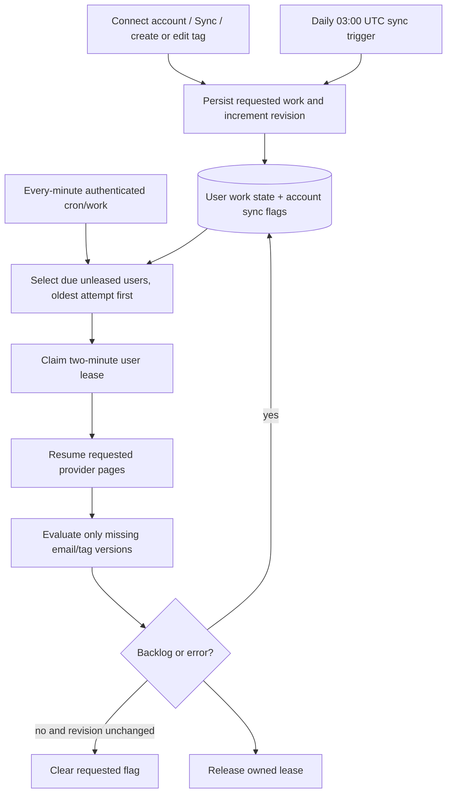

# Large inboxes: durable progress and avoiding repeat evaluation

This document describes the implementation, not a measured throughput or cost guarantee. Thousands of messages are processed over multiple bounded worker invocations. The 100-message classification batch is not a monthly allowance. See the [September 25 cost and architecture review](COST_RISK.md) for actual limits, $3.99 unit economics, retention risks and proposed safeguards. Local Supabase/Gmail access has been exercised, but production load, billing, Jev throughput and scheduled delivery remain unverified. The root `vercel.json` disables cron; `vercel.live.json` is an optional schedule configuration, not evidence of an active scheduler.

## Initial import versus incremental synchronization

Gmail's first connection imports the preceding 30 days of **Inbox** messages, 25 IDs per page, with four concurrent detail requests. It captures a history checkpoint before listing and catches up from that checkpoint after the list ends. Subsequent requested sync rounds use Gmail history, including additions, read-label changes, Inbox removals and deletion events. Imported messages do not expire merely because they become older than 30 days.

Outlook imports the entire **Inbox folder** using Graph delta, then follows the stored delta URL for later changes. A page contains up to 25 requested items. Neither provider is an all-folder archive product. A minute worker invocation does not start a fresh full-mailbox import or poll every mailbox: it processes accounts already marked `syncRequested` and classifications still missing.

Cursor, message upserts/deletions and per-account progress commit in one database transaction. A failed or interrupted uncommitted page can be fetched again safely because `(accountId, providerMessageId)` is unique. Existing rows retain their local ID, handled state and classifications; read/provider content fields refresh in place.

Page saves explicitly allow up to 20 seconds instead of Prisma's default five seconds, capped by the remaining worker deadline after connection-wait and cleanup allowances. If fetching leaves insufficient save time, the page remains pending and its cursor does not advance. This fixes the reproduced local `P2028` rollback that left the initial import at 100 messages. `syncMailboxes` can resume provider imports independently of AI evaluation and notifications; callers must still hold the user work lease. Automatic continuation requires a running worker, including during local development.

September 25 local recovery completed the saved initial import: 1,234 cached messages dated August 26–September 25 (UTC), no pending mailbox import, and zero AI calls during recovery. Gmail also returned `403 rateLimitExceeded` during unpaced recovery; pacing subsequent requests completed the import without further errors. This single-mailbox observation does not establish production throughput or automatic scheduling.

## Expired checkpoints and reconciliation

An expired Gmail history checkpoint (404) triggers a **full current-Inbox rescan**, including messages older than the initial 30-day window. Graph delta expiry (410) similarly restarts its complete Inbox traversal. `reset: true` starts reconciliation; it does not clear all cached messages.

The service persists `EmailAccount.rescanStartedAt` and refreshes `Email.lastSeenAt` for each observed message. One database clock_timestamp per page supplies both the reset marker and create/update observation timestamps, avoiding app/database clock skew. It retains existing rows and their completed evaluations while the rescan runs across worker invocations. Only after the terminal page, including Gmail history catch-up, does it delete rows not observed since the rescan began. Explicit provider tombstones can be applied earlier. A failed rescan leaves unseen cached rows present until completion, avoiding premature removal and unnecessary reclassification.

Never manually clear cursors, classification rows or an account's entire cache as a routine way to resume work. Let provider expiry initiate the documented reconciliation path. An operator-initiated destructive reset is a separate decision and can increase both work and inference usage.

## Pair/version result cache

The durable cache key is the unique `(emailId, tagId)` pair plus its recorded `tagVersion`. Match, no-match and uncertain decisions all count as completed evaluations for that version. Ordinary workers skip all three; negative decisions are not repeatedly submitted merely because they are absent from the visible matched Inbox.

A new tag creates missing pairs for existing cached mail. Editing a tag increments its version and invalidates only that tag's results; other current tag results stay reusable. A new email has missing pairs for each current tag. Explicit single-email / selected-email classification requests deliberately force re-evaluation and can incur new calls; routine background continuation does not.

`classifyEmails` selects up to 100 candidate emails per invocation. For each email it collects only missing/currently invalidated tags, then submits **one native Jev call** containing the shared email once and up to 30 independent boolean questions. Safe generated question IDs (`q0`, `q1`, …) are mapped back to validated unique tag IDs. Tag criteria are isolated inside each question's structured instructions. Empty tag sets make no request. An incomplete or malformed answer set rejects the evaluation rather than returning partial invented decisions.

The write path locks/checks the tag's evaluated version before upserting each result, preventing an old in-flight decision from becoming current after an edit. Completed results are persisted before later work is attempted. Missing work is counted again after the bounded pass so the queue remains requested while a backlog exists.

## Durable work scheduler

`User.workRequested` is the durable desired-work flag. `workRevision` increments on new requests so a worker finishing an older revision cannot clear a newer user request. `workLeaseId` and `workLeaseUntil` prevent ordinary simultaneous work for the same user; a process crash leaves a lease that another invocation can reclaim after expiry. Account-level sync leases add ownership to cursor/token updates. `EmailAccount.syncRevision` increments on new sync requests; terminal-page flag clearing checks the observed revision so an older pass cannot erase a newer account request.

`workNotBefore` defers retries. A returned processing error increments `workFailures` and applies exponential delays beginning at one minute, capped at one hour; an unexpected thrown operation is retained for retry after one minute. New manual, daily-sync and tag-change requests preserve the delay/failure counter. The user lease rejects work before the stored retry time. A classification 429 stops further model calls in that pass and persists at least a one-minute cooldown, extended by the provider retry header when present; normal worker backoff can extend it further. A thrown operation never shortens an already stored cooldown. `lastBackgroundSyncAt` records the most recent attempted worker pass and orders due users fairly, with never-attempted users first. Workers select at most 100 users per invocation and stop near their shared 45-second deadline. A large user can consume one pass, then other older-attempt users get priority on later ticks.

If the live schedule configuration is deployed, the daily `/api/cron/sync` trigger marks accounts for incremental synchronization and requests user work, `/api/cron/work` runs every minute to drain requested pages and missing classifications, and `/api/cron/digest` runs every 15 minutes. Minute scheduling requires Vercel Pro or an equivalent authorized scheduler; cached workspace query refresh is a separate preference and does not change provider schedules. The checked-in root configuration currently enables none of these schedules.

## Restart and exactly-once limits

- A crash before a provider-page transaction commits replays that page; upserts preserve identity and completed classifications.
- A crash after committed classifications skips those pairs on the next ordinary pass.
- A crash after Jev accepts a request but before its results commit can cause another model call and possible repeat billing. The app has no distributed transaction or inference-provider idempotency guarantee.
- Results from a multi-question call are persisted per tag. If only some writes commit, the next pass requests only the remaining missing tags.
- User/account leases expire; they are not permanent ownership. Database outages and hard function termination still require recovery/monitoring.
- Push and digest have separate delivery semantics. Cooperative push deadline exits release an undelivered claim, but a hard crash can strand it. Digest snapshots preserve the exact request for retry; Resend's 24-hour key retention limits deduplication.

Do not promise zero repeated calls or exactly-once billing. The implemented guarantee is reuse of durably completed pair/version results during ordinary continuation, with safe resumable provider checkpoints.

## Capacity and retention

No messages-per-second, time-to-drain or dollar-per-inbox figure has been measured against a live service. Throughput depends on provider latency/rate limits, number of missing tags, email size, Jev evaluation time, database work and cron capacity. One shared-email call reduces request count relative to one call per tag; it does not establish the provider's billing formula. Measure with authorized synthetic load and account dashboards before publishing capacity claims.

Email bodies are not stored: classification fetches up to 64,000 characters live per message (at most 24,000 sent to Jev) and the reader fetches full content on demand. Subject/snippet are bounded. Up to one classification record per cached email/current tag is retained, including negatives and uncertainty. Storage therefore grows with messages × tags plus message text/indexes; no automatic age-based retention job is implemented.

Provider removals and terminal rescan reconciliation delete affected cached mail/classifications. Mailbox disconnect removes that account's current cache; user deletion cascades all owned application data. Persisted digest payloads can retain subject/sender excerpts after a mailbox disconnect because they belong to delivery history, not the mailbox relation; only user deletion removes those rows automatically. Choose and implement an explicit delivery-history retention policy before promising complete mailbox-content erasure on disconnect. Provider-side OAuth grants and external backups/delivery retention are separate operator concerns.

## Verification boundaries

The thousand-message fixture covers ten resumable batches of 100 emails with two tags each: 2,000 cached pair results and exactly 1,000 mocked batched Jev calls. A subsequent completed pass performs zero calls, and completed negative results are reused. This is not a live performance benchmark. Queue/rescan tests cover concurrency and continuation separately. PGlite exercises the actual migration and RLS logic locally with an auth scaffold; it does not verify hosted Supabase configuration. The September 25 aggregate development-database sample in the cost review is evidence of local data, not production capacity or a representative user workload. Unexecuted production checks remain pending.

Operational setup and recovery: [RUNBOOK.md](RUNBOOK.md). Protocol details: [PROVIDERS.md](PROVIDERS.md). Complete field dictionary: [ENGINEERING.md](ENGINEERING.md).
